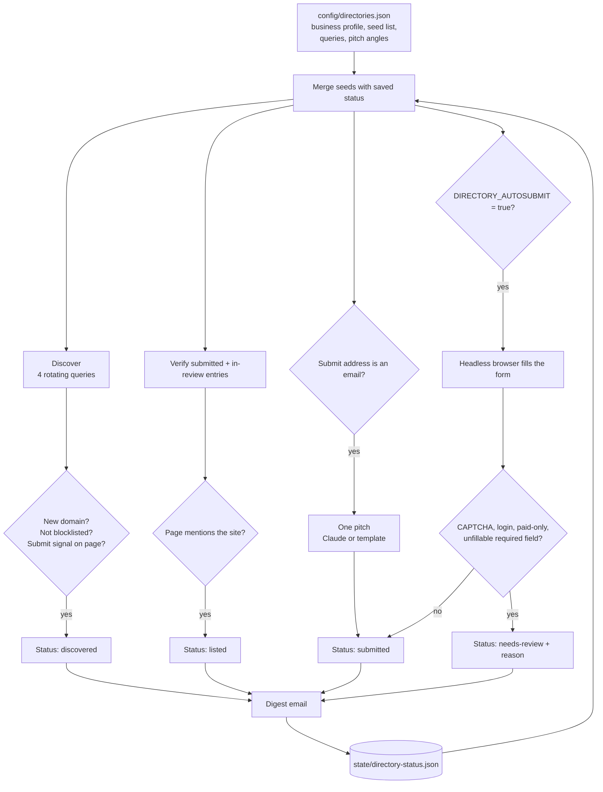

# Directory Submissions: find the directories worth being listed in, track each one to live, and report what needs a person

A weekly job for business-directory listings. It searches for new directories that accept free listings, keeps a status for every target from to-do to live, emails the targets that only take submissions by email, and sends a digest of what changed and what needs a human.

## The problem

Directory listings are slow, unglamorous link building. The work is not hard, but it is scattered: finding directories that accept free listings, remembering which ones were submitted, checking weeks later whether the listing went live, and following up on the ones that need an account or a CAPTCHA. A spreadsheet goes stale the first week nobody updates it.

Most of this can be tracked by a machine, and some of it can be done by one. The part that cannot, forms behind a CAPTCHA or a login, can at least be queued with the reason so a person spends time only where a person is needed.

## What it does

`src/directory-submissions.js` runs weekly:

1. **Discover.** Runs four search queries from a rotating list, fetches each new result, and keeps pages that show a submission signal ("add your business", "free listing", "submit your site"). The most likely submit link on the page is recorded.
2. **Verify.** Re-fetches every directory marked submitted or in manual review. If the page now mentions the site's domain, the entry flips to listed with the date.
3. **Pitch.** For targets whose submit address is an email, sends one pitch written from a per-target angle, then marks the target submitted so it is never emailed again.
4. **Auto-submit (optional, off by default).** Opens submit pages in a headless browser and fills simple forms from the business profile. Stops and queues the entry for review if it sees a CAPTCHA, a password field, paid-only wording, or a required field it has no value for.
5. **Report.** Emails counts, links that went live, pitches sent, newly discovered directories, the entries newly needing a person, and the full status table.

## Architecture



## Key design decisions

**Every target has a status, and the status drives everything.** To-do, discovered, submitted, needs-review, listed. The status file is the memory: it prevents a second pitch to the same target, decides what to verify, and is the table in the report.

**Listings are verified, not assumed.** A submission is only the start. Each run re-reads the directory page and marks the entry listed when the site's domain appears on it. Entries in manual review are checked the same way, so a listing someone creates by hand is picked up without anyone updating a tracker.

**Discovery has to earn a place in the list.** A search result is kept only if its domain is new, is not a social network, marketplace or publisher, and the page itself contains submission wording. Queries rotate weekly so each run covers different ground.

**The browser gives up early and says why.** Auto-submit refuses a form with a CAPTCHA, a password field, paid-only wording or a required field it cannot fill, and records the reason. It does not try to get around any of them.

**Auto-submit is off by default, for an honest reason.** In production it never produced a confirmed submission. Real directory pages needed an account, had no plain form, or failed to load, and every one ended in the review queue with its reason. That queue, a list of where a person is needed and why, was the useful output. The code is kept behind a flag, and every attempt saves a screenshot.

**A person is asked once.** An entry that newly needs manual work appears in the "needs you" table of that week's report. After that it is counted in a single line, not repeated every week.

**Email pitches are written from an angle, with rules.** Each email-only target has its own subject and angle in config. Claude writes the body under hard rules from the config, and a plain template is used if the API is unavailable.

**The business profile is one object.** Name, site, contact, category and description live in config and feed both the forms and the pitches.

## Repository layout

```
src/directory-submissions.js        discovery, verification, pitches, auto-submit, report
config/directories.example.json     example business profile, seed list, queries and pitch angles
scripts/test-directories.js         offline tests for detection, filters, field mapping and pitches
.github/workflows/                  weekly run, state carried in the Actions cache
```

## Setup

Requires Node 20+ and a mailbox with an app password. Playwright is an optional dependency, needed only for auto-submit.

```bash
npm install
npm test                                                     # offline, no keys needed
cp .env.example .env                                         # fill in values
cp config/directories.example.json config/directories.json   # your business and targets
npm run check                                                # discover and verify, send nothing
npm run discover                                             # discovery + report, no submissions
```

| Variable | Purpose |
|---|---|
| `GMAIL_USER`, `GMAIL_APP_PASSWORD`, `EMAIL_NOTIFY` | Pitches and the digest |
| `ANTHROPIC_API_KEY`, `CLAUDE_MODEL` | Optional AI-written pitches |
| `DIRECTORY_AUTOSUBMIT` | `true` enables the headless browser. Default off |
| `SUBMIT_LIMIT` | Maximum auto-submit attempts per run. Default 5 |
| `CLIENT_ID` | Client name sent with search and page requests |
| `CONFIG_DIR`, `STATE_DIR` | Override the `config/` and `state/` locations |

Only submit to directories whose terms allow automated submissions, and read the pitches in a `--check` run before letting the job send them.

Scheduled runs are off by default. Set the repository variable `ENABLE_SCHEDULE` to `true` to turn the schedule on; manual runs from the Actions tab always work.

---

Extracted from a production automation suite I built and ran for a live e-commerce and B2B wholesale business, 2026.

© Michael Wootan. Source shared for portfolio review; all rights reserved.
